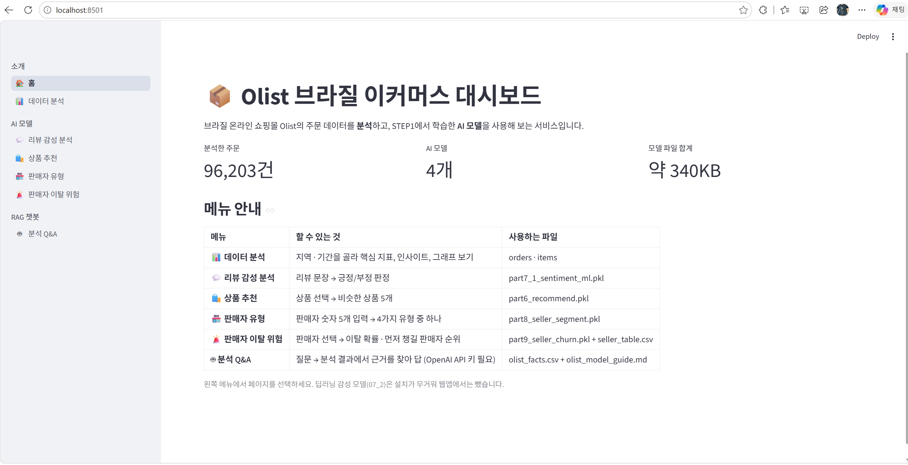
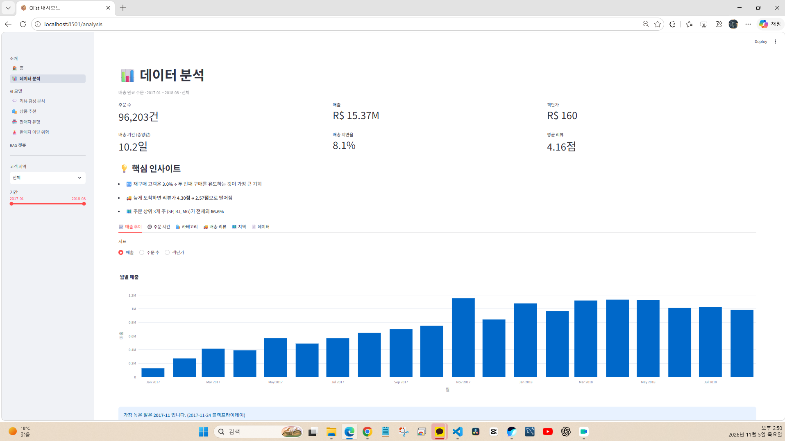
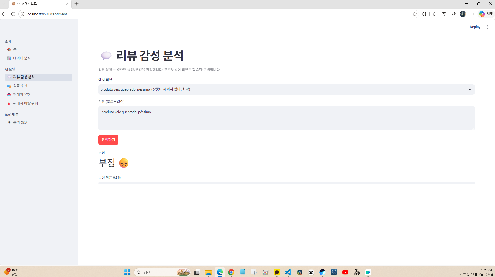
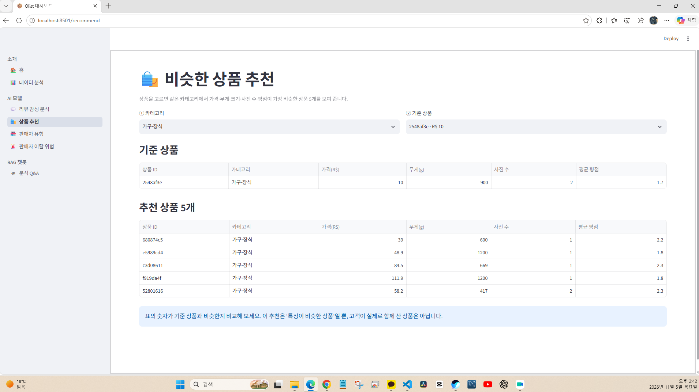
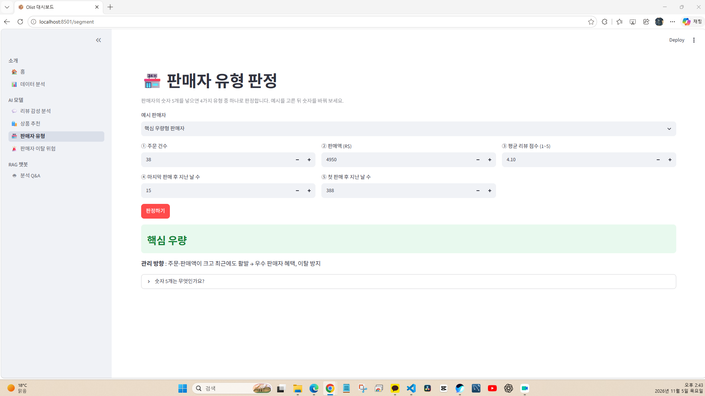
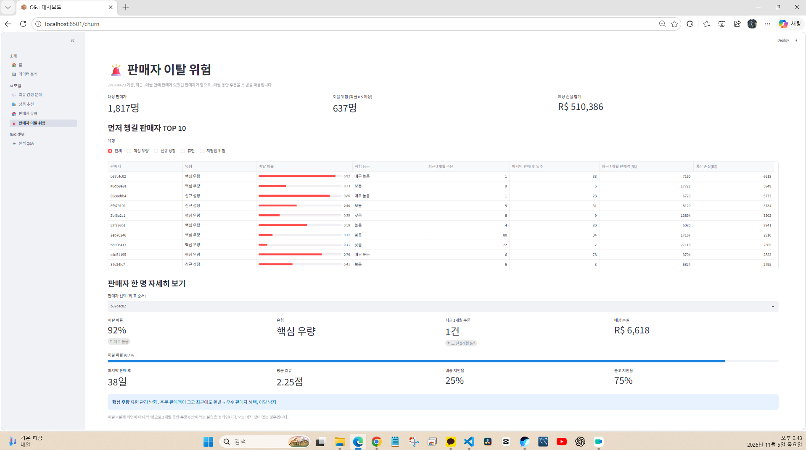
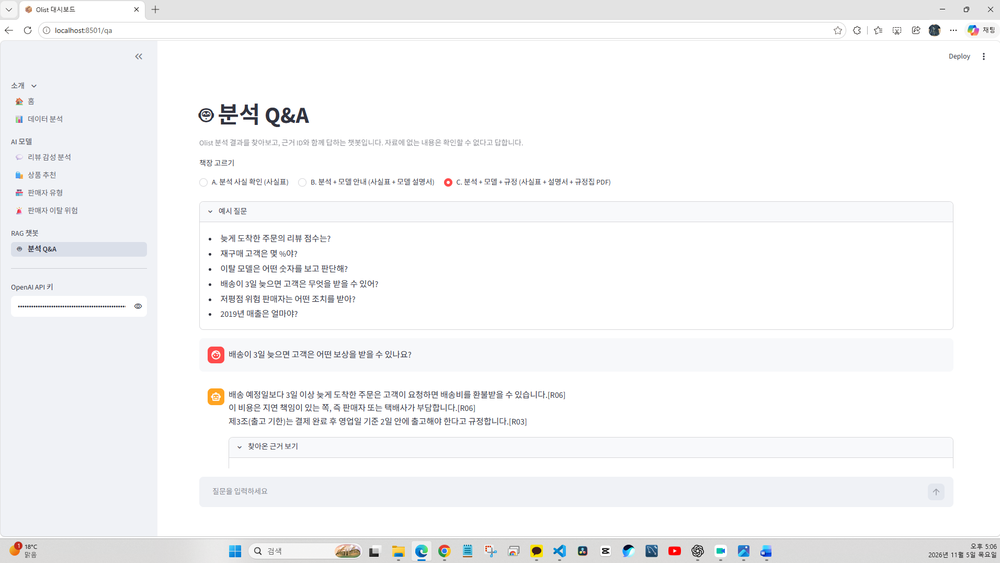
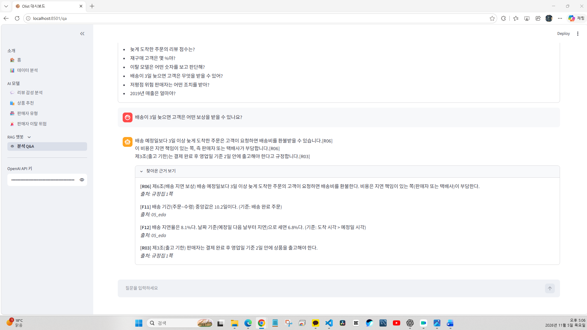

# 📦 Olist AI 데이터 분석 및 대시보드 프로젝트

> Python과 머신러닝을 활용한 브라질 이커머스 데이터 분석 프로젝트

## 📌 1. 프로젝트 소개

브라질 온라인 쇼핑 플랫폼 Olist의 데이터를 활용하여
데이터 분석, 머신러닝, AI 기반 대시보드 및 RAG 챗봇을 실습한 프로젝트입니다.

데이터 분석 결과를 사용자가 쉽게 이해하고 활용할 수 있도록
Streamlit 기반 웹 대시보드로 구현했습니다.

### 프로젝트 목표

- 이커머스 주문 및 판매 데이터 분석
- 데이터 전처리와 시각화
- 머신러닝 모델을 활용한 예측 및 추천
- Streamlit 기반 대시보드 구현
- RAG 챗봇을 통한 근거 기반 질의응답

## 📊 2. 주요 기능

| 기능 | 설명 |
|---|---|
| 🏠 홈 | 프로젝트 소개 및 주요 분석 지표 |
| 📊 데이터 분석 | 주문 데이터를 활용한 통계 및 시각화 |
| 💬 리뷰 감성 분석 | 포르투갈어 리뷰의 긍정·부정 판정 |
| 🛍️ 상품 추천 | 비슷한 특성을 가진 상품 5개 추천 |
| 🏪 판매자 유형 | 판매자 데이터를 활용한 유형 분류 |
| 🚨 판매자 이탈 위험 | 판매자의 이탈 위험 예측 |
| 🤖 분석 Q&A | 분석 결과와 근거ID를 활용한 질의응답 |

## 🛠️ 3. 사용 기술

- Python
- Pandas / NumPy
- Scikit-learn
- Streamlit
- LangChain
- OpenAI API
- Google Colab
- Visual Studio Code

## 📁 4. 프로젝트 폴더 구조

```text
olist_dashboard/
├── app.py
├── requirements.txt
├── README.md
├── .gitignore
├── data/
├── model/
├── utils/
└── views/
```

## ⚠️ 5. 프로젝트 안내
본 프로젝트는 AI 기반 데이터 저널리즘 교육과정에서
데이터 분석 및 머신러닝 활용 방법을 학습하기 위해 제작했습니다.

AI 모델의 예측값은 실제 결과를 보장하지 않으며,
분석 결과를 활용할 때는 데이터의 출처와 집계 기준을 확인해야 합니다.

또한 RAG 챗봇의 답변에 포함된 근거ID는
실제 자료에 존재하는지 별도로 검증해야 합니다.

## ▶️ 6. 프로젝트 실행 방법

### 1단계: 프로젝트 폴더 열기

VS Code에서 `olist_dashboard` 폴더를 엽니다.

### 2단계: 가상환경 만들기

Windows PowerShell 터미널에서 실행합니다.

```powershell
py -3.10 -m venv .venv
```

### 3단계: 가상환경 활성화

```powershell
.\.venv\Scripts\Activate.ps1
```

### 4단계: 필요한 패키지 설치

```powershell
python -m pip install -r requirements.txt
```

### 5단계: 대시보드 실행

```powershell
python -m streamlit run app.py
```

실행 후 터미널에 표시되는 로컬 주소로 접속합니다.

일반적으로 다음 주소를 사용합니다.

`http://localhost:8501`

### 참고 사항

- 분석 데이터와 학습된 모델 파일이 필요합니다.
- 분석 Q&A 기능은 별도의 OpenAI API 키가 필요합니다.
- API 키는 GitHub에 업로드하지 않습니다.
- Python 버전과 패키지 호환성은 실행 환경에 따라 확인해야 합니다.

## 📸 7. 프로젝트 실행 화면

### ① 대시보드 홈
프로젝트 소개와 주요 분석 지표를 확인할 수 있습니다.



### ② 데이터 분석
Olist 주문 데이터의 주요 지표와 그래프를 확인합니다.



### ③ 리뷰 감성 분석
포르투갈어 리뷰 문장을 분석하여 긍정 또는 부정을 예측합니다.



### ④ 상품 추천
선택한 상품과 특성이 비슷한 상품 5개를 추천합니다.



### ⑤ 판매자 유형 분석
판매자의 활동 데이터를 바탕으로 유형을 분류합니다.



### ⑥ 판매자 이탈 위험 예측
판매자의 이탈 위험을 예측하여 확인합니다.



### ⑦ RAG 분석 Q&A
분석 결과와 모델 설명, 실습용 규정집을 활용하여 질문에 답변하고 근거ID를 표시합니다.





## 📄 8. 프로젝트 발표자료

Olist 데이터 분석부터 머신러닝, Streamlit 대시보드, RAG 챗봇까지의 전체 실습 과정을 정리한 PDF 발표자료입니다.

### 📥 발표자료 보기

[📘 Olist AI 프로젝트 전체 발표자료 PDF 열기](docs/Olist_AI_Project_Portfolio.pdf)
---

## 🧠 9. 딥러닝 리뷰 감성분석 기능 추가 (2026.11.09)

### 9-1. 실습 목적

기존 Olist AI 대시보드에 딥러닝 리뷰 감성분석 기능을 추가하고, 기존 머신러닝 모델과 결과를 비교했습니다.

- 개발 환경: Windows 11, VS Code, Python 3.12.10
- 웹 프레임워크: Streamlit
- 딥러닝 라이브러리: TensorFlow 2.21.0
- 데이터: Olist 포르투갈어 상품 리뷰
- 참고 자료: journal-izm/Olist-Data-Analysis

### 9-2. 추가한 파일

| 파일 | 역할 |
|---|---|
| model/part7_2_tokenizer.pkl | 리뷰 문장을 숫자로 변환 |
| model/part7_2_sentiment_model.keras | 딥러닝 감성분석 모델 |
| utils/deep_sentiment.py | 모델 불러오기 및 예측 |
| views/sentiment_dl.py | Streamlit 분석 화면 |
| app.py | 딥러닝 분석 메뉴 등록 |
| requirements.txt | TensorFlow 의존성 추가 |

기존 머신러닝 감성분석 기능은 삭제하지 않았습니다.

### 9-3. 머신러닝과 딥러닝 비교

동일한 포르투갈어 리뷰 2개를 입력하여 두 모델의 결과를 비교했습니다.

| 리뷰 | 머신러닝 판정 | 머신러닝 긍정 점수 | 딥러닝 판정 | 딥러닝 긍정 점수 |
|---|---|---:|---|---:|
| produto muito bom gostei | 긍정 | 98.9% | 긍정 | 99.3% |
| produto ruim nao gostei | 부정 | 1.8% | 부정 | 8.3% |

두 모델 모두 이번 테스트에서 기대한 감성으로 분류했습니다.

다만 예시 2개만으로 모델의 전체 정확도나 우수성을 판단할 수는 없습니다.

### 9-4. 오류 처리 테스트

| 테스트 | 실행 결과 |
|---|---|
| 긍정 리뷰 | 정상 분석 |
| 부정 리뷰 | 정상 분석 |
| 빈 문장 입력 | 입력 안내 메시지 표시 |
| 학습된 단어가 없는 한국어 문장 | 포르투갈어 입력 안내 |
| 기존 머신러닝 화면 | 정상 작동 |

### 9-5. AI 활용 및 검증

- With AI: ChatGPT를 활용하여 딥러닝 모델 연결 코드와 Streamlit 화면 코드를 작성했습니다.
- 직접 수행: GitHub 업로드, VS Code 실행, TensorFlow 설치, 모델 예측 및 결과 확인을 진행했습니다.
- WO AI(Without AI): AI 도움 없이 분석한 별도 결과는 이번 비교에 포함하지 않았습니다.
- 검증: 동일한 긍정·부정 리뷰를 두 모델에 입력하여 결과를 비교했습니다.

### 9-6. 한계 및 주의사항

- 본 모델은 포르투갈어 리뷰를 대상으로 학습했습니다.
- 한국어와 영어 분석 결과는 신뢰하기 어렵습니다.
- 모델의 긍정 예측 점수는 실제 정답 확률을 보장하지 않습니다.
- 정식 성능 비교에는 별도의 정답 데이터와 정확도 등의 평가 지표가 필요합니다.
- 실제 고객 리뷰를 수집할 때는 개인정보와 데이터 이용 조건을 확인해야 합니다.

### 9-7. 참고 출처

- 원본 프로젝트: https://github.com/journal-izm/Olist-Data-Analysis
- 내 프로젝트: https://github.com/heumpc0922/olist-ai-dashboard